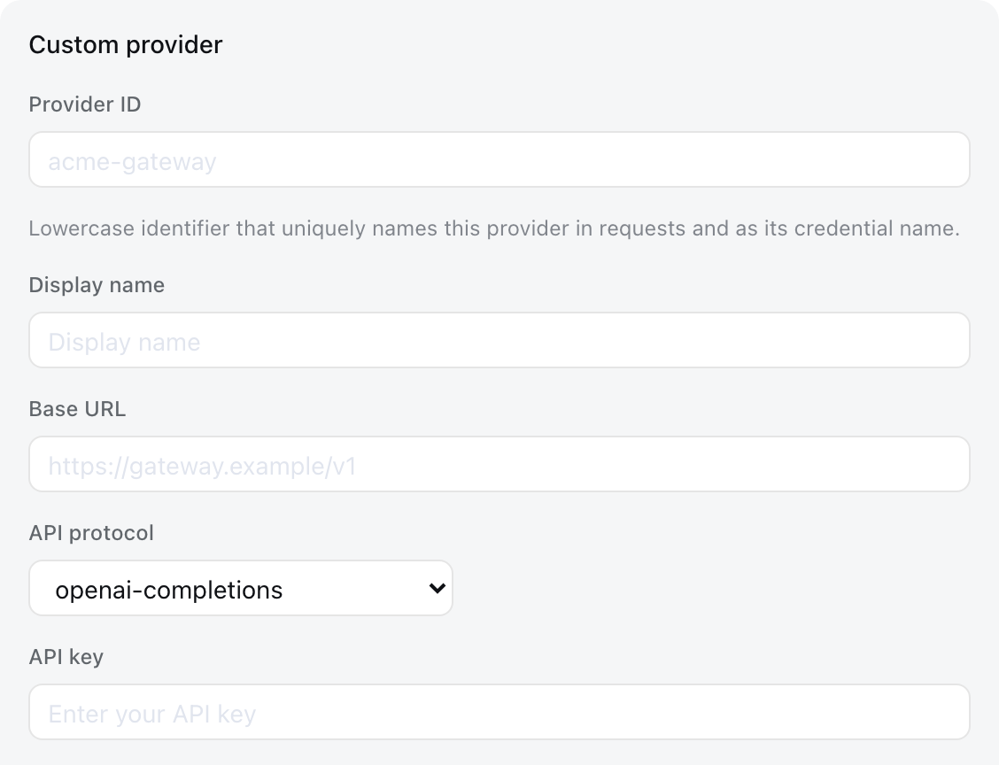

# Configure models

English | [Português](providers.pt-BR.md)

This guide assumes you started the Web UI through the [root README](../../../README.md#run). Model changes take effect on the next request without restarting the server.

## Add a catalog provider

No provider ships configured: a fresh install serves no model until you add one, and which one is your choice.

Open **Settings → Models** and choose **Add provider**, select a provider such as Anthropic or OpenAI, enter its API key, and save. The installed catalog supplies the endpoint, protocol, and model list.

Keys are write-only. The page receives a redacted descriptor after saving, never the literal secret. The key is stored in `$ARX_HOME/.credentials.yaml`, while settings retain only its credential reference.

Providers with native authentication need their native credentials instead. Bedrock, Vertex, Azure, and Codex use AWS credentials and a region, an ADC project, an `api-version`, and OAuth respectively; filling only the API-key field does not configure them.

## Add a custom provider

Choose **Add a custom provider** for a company gateway, self-hosted server, or provider absent from the installed catalog. Supply a lowercase Provider ID, base URL, API protocol, credential, and at least one model.



The Provider ID is permanent because requests, saved sessions, model defaults, and credential references use it. To rename a provider, add a new provider and delete the old one. The display name, base URL, protocol, credential, and models remain editable.

Under **Model catalog**, choose **Fetch available models** to query the base URL and credential currently shown in the form. Selecting candidates updates the draft; the provider is not stored until you save. Catalog providers use their installed catalog without a network request.

### A local model server

Ollama, llama-server, vLLM, and LM Studio all speak the OpenAI-compatible protocol, so each is a custom provider pointed at `127.0.0.1`. No paid key is involved, but the route still needs a credential *reference*: a profile naming none is refused with `No API key for provider` before any request leaves the process. Name an environment variable and give it any non-empty value — a local server ignores the `Authorization` header.

```yaml
llm-pi-ai:
  providers:
    ollama:
      displayName: Ollama
      apiKeyEnv: OLLAMA_API_KEY
      api: openai-completions
      baseURL: http://127.0.0.1:11434/v1
      models:
        - id: qwen3:8b
          contextWindow: 40960
```

Give every model its real `contextWindow`. A model entered without one inherits a 262144-token default that most local models do not serve, and automatic compaction reads that figure to decide when to summarize — so the session overruns the model's actual window before compaction starts.

### Image input

A model you enter by hand is treated as text-only until it says otherwise, because nothing can ask an endpoint which modalities it accepts. Attaching an image to such a model is refused before it is sent, naming the model.

A vision model on a custom provider therefore needs one line. The form has no field for it; add `input` to the model in `$ARX_HOME/settings.yaml`:

```yaml
llm-pi-ai:
  providers:
    my-gateway:
      apiKeyEnv: GATEWAY_API_KEY
      api: openai-completions
      baseURL: https://gateway.example/v1
      models:
        - id: legacy-chat
        - id: vision-preview
          input: [text, image]
```

`input` accepts `text` and `image`, and applies to that model alone, so one route can serve both kinds. Omitting it — or writing an empty list, which means the same thing — keeps whatever the installed catalog records for that model, and falls back to the route's `defaultInput` for a model the catalog does not describe.

If every model you entered by hand takes images, set the fallback once on the route instead of on each of them:

```yaml
llm-pi-ai:
  providers:
    vision-gateway:
      apiKeyEnv: GATEWAY_API_KEY
      api: openai-completions
      baseURL: https://vision.example/v1
      defaultInput: [text, image]
      models:
        - id: first-model
        - id: second-model
```

`defaultInput` is a fallback, not an override, and defaults to `[text]`: on a catalog provider it answers only for models the catalog does not describe, so it never removes images from a catalog model that has them. Narrow one of those with that model's own `input`. A catalog provider has no `models` list to put it in, so write it under `modelOverrides`, keyed by model id:

```yaml
llm-pi-ai:
  providers:
    anthropic:
      modelOverrides:
        claude-sonnet-4-5:
          input: [text]
```

Every list must name at least one modality except a model's own, where an empty list means the same as omitting it. An unknown modality is refused wherever it is written.

Both fields state a claim about your endpoint rather than checking it. A model that declares images its endpoint does not serve is not caught here; the provider rejects the request instead.

### Request compatibility

A gateway can hold a working key at a reachable address and still refuse every request. pi-ai decides the shape of a request — which role carries the system prompt, which field caps the output, how a thinking level travels — from the endpoint's URL, and an address it does not recognize is addressed as though it were OpenAI itself. Most OpenAI-compatible gateways refuse at least one thing OpenAI accepts.

Two account for most of it. A model that declares reasoning has its system prompt sent as `role: "developer"`, which many gateways reject outright, and the output cap is sent as `max_completion_tokens`, which a server that only knows `max_tokens` refuses. The form has no field for either; correct them on the route in `$ARX_HOME/settings.yaml`:

```yaml
llm-pi-ai:
  providers:
    my-gateway:
      apiKeyEnv: GATEWAY_API_KEY
      api: openai-completions
      baseURL: https://gateway.example/v1
      compat:
        supportsDeveloperRole: false
        maxTokensField: max_tokens
      models:
        - id: my-model
```

A route's `compat` is the default for its models, and a model's own wins field by field, so one model can be corrected without restating the route:

```yaml
      models:
        - id: my-model
        - id: my-reasoner
          compat:
            thinkingFormat: deepseek
```

What neither sets keeps the installed catalog's value for that model, and what the catalog does not describe falls to pi-ai's detection. Give every switch you name a value: a key left empty (`supportsDeveloperRole:`) is refused rather than ignored, because an empty value would erase what the catalog knows while saying nothing in its place. A name no protocol accepts is refused too, and the message lists the ones that are available.

Each switch belongs to the protocols that declare it, so a switch valid on one `api` may be refused on another — the message names what that protocol does offer. Like `input` above, a switch states a claim about your endpoint rather than checking it: setting one your gateway does not actually need simply sends a different request.

Every switch, its accepted values, and the protocols that take it are listed under `PiAiCompatProfile` in the [generated `arx-llm-pi-ai` configuration reference](../../config-catalog.md#arx-aiarx-llm-pi-ai) — which is derived from the source, so it cannot fall behind what the adapter accepts.

## Use a subscription CLI as a provider

A vendor command-line tool already installed and signed in on this machine can serve as an ordinary model route. The harness keeps its own agent loop, tools, sandbox, and session log; only the transport to the model changes, and no API key is stored anywhere — the route uses the login the tool already holds.

Check that the tool's own login is in place before configuring the route, using whatever command it provides. A route whose tool is absent or signed out fails at the first request, not at save.

Read your subscription's terms first. Driving a subscription tool from another program may exceed what that subscription permits, and that judgement is yours to make: the harness neither checks nor asserts anything about it.

Open **Settings → Models**, choose **Add provider**, and select **Claude (subscription)**. The card asks for no key, endpoint, or protocol. Add at least one model. A model named by its full id, such as `claude-sonnet-4-5`, takes its context window, output cap, and image input from the catalog installed with the harness; a vendor alias such as `sonnet`, or an id that catalog does not list, needs its **Context window** filled in, because automatic compaction resolves capacity from the route serving the request and the tool discloses none of its own. **Apply** refuses such a model and names it. Tick **Accepts images** for a model outside the catalog that takes image input, and choose **Apply**. The route takes effect on the next request, without restarting the server, and its models appear in the model picker like any other.

**Fetch available models** lists the models the tool's login can reach, by id. It starts the tool once to ask, so it needs the tool installed and signed in. It returns the tool's aliases, so each model you adopt from it still needs its context window.

The **Native product accounts** card on the same page shows whether Claude Code and Codex are installed and signed in on this machine and starts their own sign-in: in a browser, or with a device code for Codex. When the tool asks for a code, the card shows a field for it. For a Claude Code account signed in with a subscription, **Enable in chat** writes the `claude-subscription` route with the models the account reports, under their full ids, so their context windows come from the catalog. The **OpenAI Codex chat models** card signs the library-backed `openai-codex` route in with your OpenAI subscription and then enables it; that sign-in is separate from the Codex tool's own. Both cards appear only in a browser on the machine that runs the harness, or through an authenticated local tunnel to it.

The page writes the `llm-agent-cli` section of `$ARX_HOME/settings.yaml`, which you can also edit directly:

```yaml
llm-agent-cli:
  providers:
    claude-subscription:
      models:
        - id: claude-sonnet-4-5
          contextWindow: 200000
          maxTokens: 8192
          acceptsImages: true
```

A model the route does not list is refused rather than sent, so list every model you intend to select.

## Select a model

Configured providers appear in the model picker. Selecting a model also makes it the default for new sessions. A session that has already sent a request retains the model recorded in its own log.

If a saved default names a provider that was deleted, the composer displays **Select model** and blocks input until another model is selected.

## Troubleshooting

- **`MISSING_CREDENTIAL`** — Store the provider key through the Models page or supply the referenced environment variable.
- **`UNKNOWN_MODEL`** — Select a configured model or add the missing model to the custom provider.
- **Apply refuses a subscription model and names it** — The installed catalog does not list that id: it is an alias, or newer than the catalog. Fill in its **Context window**, or use the model's full id.
- **Fetching available models returns 401** — Check the key. Model discovery calls the OpenAI-compatible `GET /models` endpoint; enter models manually for endpoints that do not provide it.
- **The gateway refuses every request although the key and URL are right** — Its request shape differs from OpenAI's. Start with `compat.supportsDeveloperRole: false` and `compat.maxTokensField: max_tokens` on the route.
- **Only reasoning models fail** — pi-ai sends their system prompt as the `developer` role, which the gateway rejects. Set `compat.supportsDeveloperRole: false`.
- **A compat switch is refused as having no value** — A key written with nothing after the colon. Give it a value, or remove the key to keep the installed catalog's.
- **An image is refused before sending** — The model declares no image modality. Give a custom provider's model `input: [text, image]`; a text-only chat-completions route cannot be configured into accepting images.
- **The provider rejects a request carrying an image** — The model declares images its endpoint does not actually serve. Remove `image` from whichever list granted it — the model's `input`, or the route's `defaultInput` — then start a new session: the attached image stays in the session log, so the same request repeats until the session moves off it.
- **A subscription CLI route fails every request** — Its command-line tool is absent from this machine or signed out. The route carries no credential to check at save, so the first request is where it shows.

## Advanced configuration

The generated [plugin configuration catalog](../../config-catalog.md) lists every supported field and default for every plugin; [`arx-llm-pi-ai`](../../config-catalog.md#arx-aiarx-llm-pi-ai) is the provider section this page configures. The [`arx-llm-pi-ai`](../../../packages/llm/llm-pi-ai/README.md) reference owns direct `settings.yaml` configuration, catalog resolution, reasoning controls, credentials, and adapter errors. The [`arx-llm-agent-cli`](../../../packages/llm/llm-agent-cli/README.md) reference owns the subscription-CLI route: its full field list, its reasoning controls, and what the vendor tool does and does not disclose.
